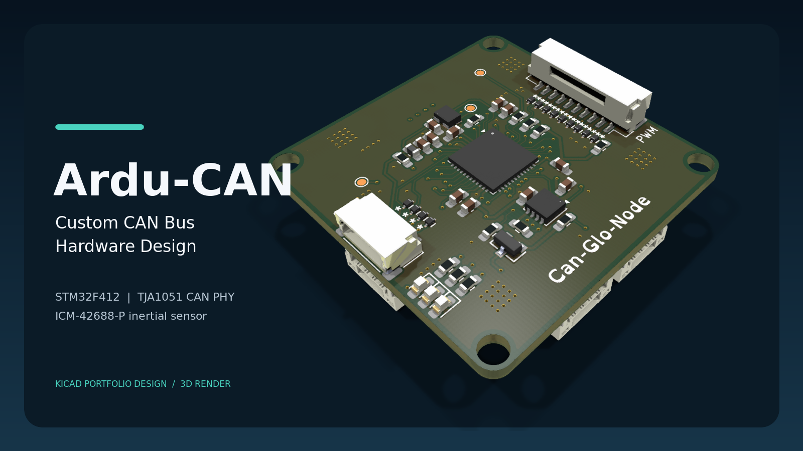
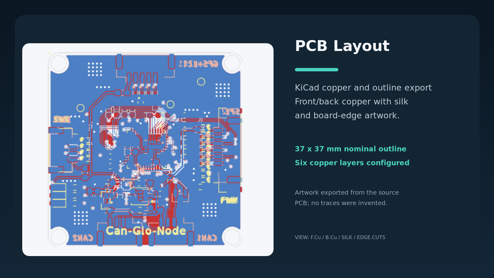
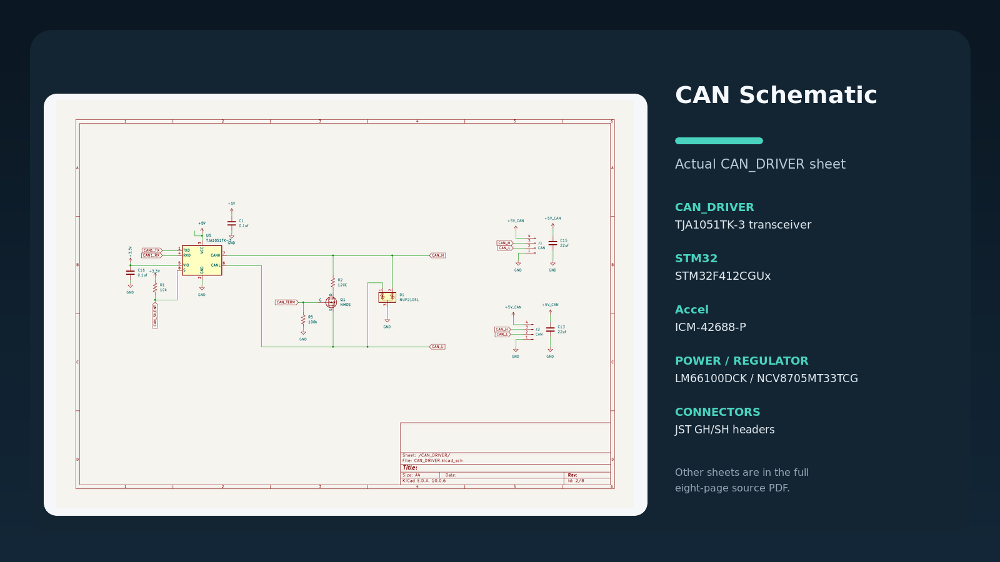
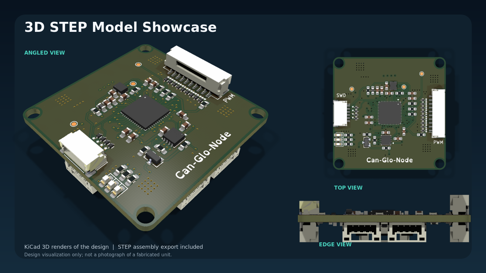
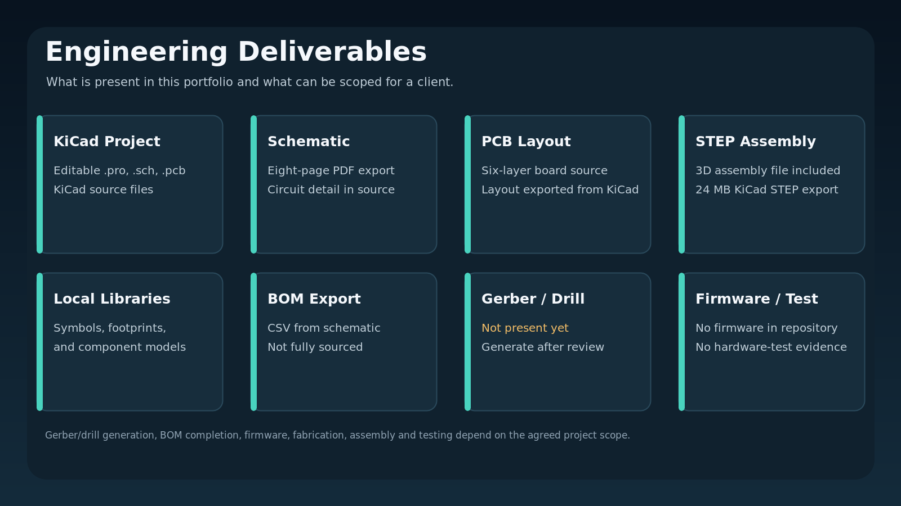

# Ardu-CAN

Ardu-CAN is a compact embedded-controller PCB design portfolio built in KiCad.
It brings together an STM32F412 MCU, CAN-bus interface circuitry, an inertial
sensor, power-protection and regulation circuits, and a custom board layout.

Explore the editable KiCad design, project libraries, engineering exports, and
3D assembly model below. The repository also documents the current design
review and next steps toward a fabrication release.

> **Board identity:** the PCB silkscreen currently says `Can-Glove-Node`.
> `Ardu-CAN` is the portfolio/project name used in this repository.

## Contents

- [Project objectives](#project-objectives)
- [Verified hardware features](#verified-hardware-features)
- [Hardware architecture](#hardware-architecture)
- [PCB design overview](#pcb-design-overview)
- [Schematic and engineering exports](#schematic-and-engineering-exports)
- [3D model](#3d-model)
- [Engineering review and release status](#engineering-review-and-release-status)
- [Open the project in KiCad](#open-the-project-in-kicad)
- [Commercial design services](#commercial-design-services)
- [Licensing and third-party assets](#licensing-and-third-party-assets)

## Project objectives

The project brings together an STM32 microcontroller, a CAN physical-layer
interface, an inertial measurement component, power input protection, and
connectors on a custom PCB. It demonstrates schematic capture, component and
footprint selection, board placement and routing, local KiCad library assets,
and 3D assembly export.

This portfolio focuses on the hardware design and its engineering assets.
Firmware and system-level behavior can be scoped separately for projects that
need them.

## Verified hardware features

The following parts and design elements were confirmed in the checked-in
schematic/PCB data and the KiCad BOM export:

| Design element | Verified implementation |
| --- | --- |
| Main MCU | U8, `STM32F412CGUx`, in a 48-pin QFN footprint |
| CAN physical layer | U5, `TJA1051TK-3` CAN transceiver; J1 and J2 are labeled `CAN` |
| CAN protection | D1 is `NUP2105L`; ESD9C3.3ST5G protection components also appear in the design |
| Inertial sensor | U4, `ICM-42688-P` |
| 3.3 V regulator | U6, `NCV8705MT33TCG` |
| Input protection | U1, `LM66100DCK`, on the reverse-polarity-protection sheet |
| Clock component | X1, `LFSPXO072801REEL` |
| Connections | JST GH/SH connectors and headers, including two 4-pin connectors labeled `CAN` |
| Test access | Three test-point footprints are present in the exported BOM |

The STM32F412 family datasheet lists an on-chip bxCAN controller
([STMicroelectronics datasheet](https://www.st.com/resource/en/datasheet/stm32f412cg.pdf));
U5 is the separate TJA1051 physical-layer transceiver. The schematic therefore
contains both controller-capable MCU hardware and a CAN transceiver, but the
repository has no firmware or test evidence establishing bus operation,
bit-rate, termination behavior, or protocol-level performance.

The schematic also contains passives, fuses, LEDs, and other protection
components. Part ratings, exact connector pin assignments, supported CAN
bit-rates, sensor configuration, and system behavior must be confirmed against
the detailed design and component datasheets before use.

## Hardware architecture

The KiCad schematic is organized into these sheets:

- `REVERSE_POLARITY_PROTECTION`
- `POWER_SUPPLY`
- `3.3_REGULATOR`
- `STM32`
- `CAN_DRIVER`
- `Accel`
- `CONNECTORS`

The exported schematic PDF includes the hierarchy page and all seven circuit
sheets. Current electrical review findings are summarized in the validation
section below.

## PCB design overview

- Nominal board outline: **37 × 37 mm**, as drawn on `Edge.Cuts`.
- Configured board thickness: **1.6 mm**.
- Configured copper stackup: **six copper layers** (front, four inner layers,
  and back).
- The outline contains four circular, nominal 3 mm diameter `Edge.Cuts`
  features. Confirm their intended use and mechanical clearances in the final
  enclosure and fabrication review.
- The source PCB contains 82 footprints and routed copper. This count is from
  the board file and is not an assembly or production status.

## Schematic and engineering exports

The schematic illustration below shows the actual KiCad CAN-driver sheet with
a summary of other verified blocks. For readable circuit detail, use the full
PDF rather than relying on the thumbnail.

- [Full eight-page schematic PDF](docs/ardu-can-schematic.pdf)
- [KiCad-exported BOM CSV](docs/ardu-can-bom.csv)
- Editable root schematic: [`ardu-can.kicad_sch`](ardu-can.kicad_sch)
- Editable board: [`ardu-can.kicad_pcb`](ardu-can.kicad_pcb)
- KiCad project settings: [`ardu-can.kicad_pro`](ardu-can.kicad_pro)
- Project symbol/footprint tables: [`sym-lib-table`](sym-lib-table) and
  [`fp-lib-table`](fp-lib-table)
- Custom and supporting KiCad libraries: [`lib/`](lib/)
- Component 3D models used by the project: [`model/`](model/)

The CSV is an exported design BOM, not a fully sourced purchasing BOM: supplier
part numbers, lifecycle checks, alternates, and procurement verification are
not established by that export.

## 3D model

The repository includes a KiCad-generated STEP assembly model. The image below
shows KiCad renders from multiple board views; it is not a photograph of a
fabricated or assembled unit.

- [Assembly STEP model](3d/ardu-can-assembly.step)
- [KiCad component model assets](model/)

The STEP file is an export of the current design data. No independent
mechanical fit, enclosure, or third-party CAD validation is claimed.

## Engineering review and release status

The project has editable KiCad design files and exported engineering assets.
Use the validation review to plan the next engineering steps before fabrication.

View current ERC/DRC findings and release checks

- The KiCad 10.0.6 PCB DRC reports **458 violations**, including via diameter
  and annular-width findings, library-footprint mismatches, clearance and
  copper-to-edge findings, silkscreen/courtyard issues, dangling tracks, and
  one unconnected item.
- The schematic ERC reports **61 violations**: 11 errors and 50 warnings.
  Findings include hierarchical sheet-pin/label mismatches, undriven power
  pins, and pin-type warnings.
- The source includes project-specific symbol and footprint tables, but the
  current checks still report footprint-library association/mismatch issues.
- No Gerber, drill, pick-and-place, or fabrication job output files are
  included.
- No fabricated-board, assembly, electrical bench test, or firmware validation
  evidence is included.

The detailed [design review](docs/design-review.md), [PCB DRC report](docs/pcb-drc-report.txt),
and [schematic ERC report](docs/schematic-erc-report.txt) provide the exact
findings. The release workflow is to resolve and rerun ERC/DRC, verify library
associations and footprint assignments, check the outline, holes, connector
mating clearances, enclosure fit, stack-up, and fabricator capabilities, then
generate and inspect Gerber/drill outputs and complete a sourced BOM as needed.

## Open the project in KiCad

1. Use **KiCad 10** (the checked CLI version for the exports and checks in this
   repository was 10.0.6).
2. Open `ardu-can.kicad_pro` from the repository root.
3. Open the root schematic or PCB editor from the project manager.
4. Keep the `lib/` and `model/` folders in their current relative locations:
   the project tables and footprints use project-relative library/model paths.
5. Review the current ERC/DRC findings before editing or preparing fabrication
   data.

Opening the project in another KiCad version may prompt a file-format upgrade.
Make a separate copy before accepting a project-wide upgrade.

## Commercial design services

This project is a portfolio example of the kinds of schematic, PCB layout,
component/footprint, and 3D STEP work available as a custom service. It does not
establish that every feature in a future client design is included, tested, or
certified.

The service scope, revision allowance, source files, manufacturing outputs,
firmware, and testing are defined per project and agreed package. Fabrication,
assembly, firmware development, and physical testing are not included unless
explicitly agreed.

See the [Fiverr listing and packages](docs/fiverr-gig.md) for service details.

## Licensing and third-party assets

No blanket project license is included because the repository combines original
design files with library/model assets that may have separate license terms.
The ICM-42688-P library folder includes its own `License.txt`; retain and review
third-party notices before redistribution or commercial reuse. Agree ownership
and licensing for client deliverables in writing before work begins.
